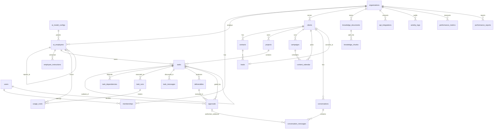

# 04. Database Schema & ER Diagram

Files: [`sql/001_schema.sql`](sql/001_schema.sql) (DDL) and [`sql/002_seed.sql`](sql/002_seed.sql) (sample records).

**Verified on 2026-11-27:** both files were loaded into a fresh PostgreSQL 16 + pgvector instance without errors (27 tables, 15 AI employees seeded). Three guard rails were tested and correctly rejected bad writes:
- inserting a task dependency that would create a cycle → `task dependency cycle detected`
- deleting from `activity_logs` → `activity_logs is append-only`
- marking an approval `approved` without `decided_by`/`decided_at` → check constraint violation

## Module → table map (all 21 requested modules)

| Requested module | Table(s) |
|---|---|
| Users | `users`, `memberships` (role per org) |
| Organizations | `organizations` |
| AI Employees | `ai_employees` |
| Employee Instructions | `employee_instructions` (versioned, one active per kind/name) |
| Clients | `clients` |
| Projects | `projects` |
| Tasks | `tasks`, `task_runs` (execution log), `task_messages` |
| Task Dependencies | `task_dependencies` (+ cycle-prevention trigger) |
| Campaigns | `campaigns` |
| Content Calendar | `content_calendar` |
| Leads | `leads` |
| Contacts | `contacts` |
| Conversations | `conversations`, `conversation_messages` |
| Approvals | `approvals` (stores exact payload + hash to execute) |
| Deliverables | `deliverables` |
| Knowledge Base | `knowledge_documents`, `knowledge_chunks` (pgvector HNSW) |
| AI Model Configurations | `ai_model_configs` |
| API Integrations | `api_integrations` (secret_ref only, never secrets) |
| Usage and Costs | `usage_costs` |
| Activity Logs | `activity_logs` (append-only, hash-chained) |
| Performance Reports | `performance_reports`, `performance_metrics` (value_type actual/target/estimate) |

## ER diagram

## Key constraints & indexes (why they exist)

- `tasks` CHECKs: must have an owner; `requires_approval ⇒ approval_category`; `completed ⇒ completed_at` (a task cannot be "completed" without a timestamp the system set).
- `approvals`: decided status ⇔ decider + time; `executed_at` only when approved; `payload_hash` lets the executor refuse if the payload was altered after approval.
- `conversation_messages`: an AI-authored outbound message must reference an approval.
- `performance_metrics.value_type` is NOT NULL: every number is labelled actual / target / estimate.
- `employee_instructions`: partial unique index ensures exactly one active prompt version.
- Board query index `ix_tasks_board (organization_id, status, priority, deadline)`; approval inbox partial index on `status='pending'`; HNSW cosine index for RAG.
- Row-level security (Phase 8): enable RLS on all tenant tables with `organization_id = current_setting('app.org_id')::uuid`.

## Sample records (in seed)
PMR org, a founder user, 3 model configs, all 15 AI employees with tool scopes, a fictional demo client (`demo-dental.example.com`), a project with 3 dependent tasks (audit → keyword map → service-page drafts, last one gated `publish_content`), one fictional lead, and the $10k MRR stored explicitly as a **target**.
